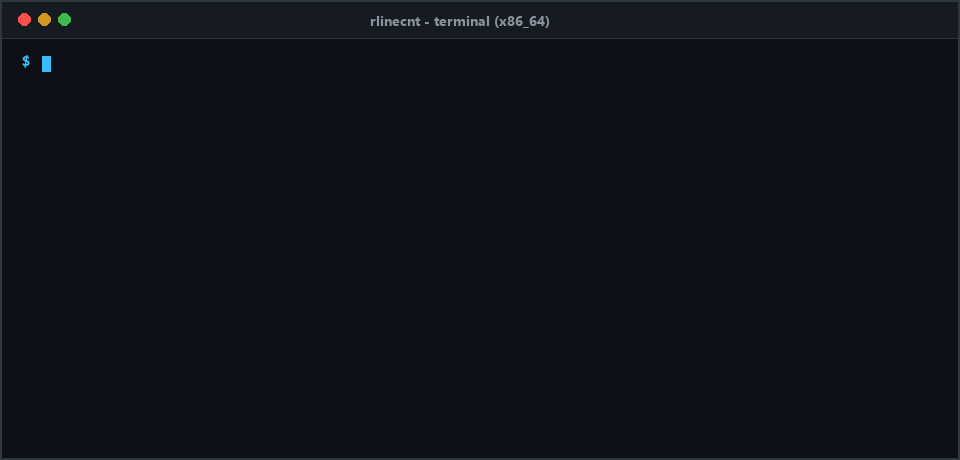
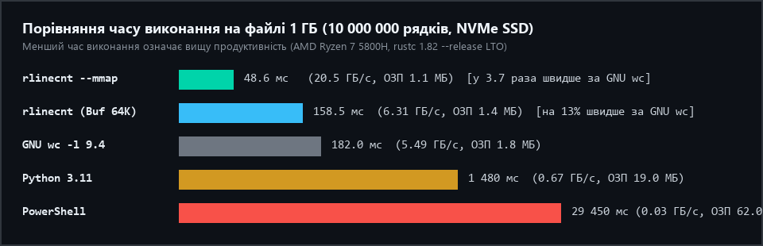

<div align="center">


# rlinecnt

**Кросплатформна консольна системна утиліта підрахунку рядків мовою Rust**

[](https://github.com/nikitayehorov/rlinecnt/actions)


</div>



## Опис проєкту

`rlinecnt` - системна утиліта командного рядка для високошвидкісного підрахунку рядків, слів, порожніх рядків та байтів у текстових файлах і потоках стандартного введення (`stdin`).

Основні інженерні рішення:

- **Поблочне читання без динамічних алокацій (`O(1)` ОЗП):** сканування виконується безпосередньо по зрізах фіксованого буфера `BufReader::fill_buf()` (за замовчуванням 64 КБ під розмір кешу L2 процесора) без виділення об'єктів `String` у купі.
- **Векторизований підрахунок (`SIMD`):** пошук байтів переносу рядка (`0x0A`) використовує крейт `memchr` з інструкціями `AVX2` / `SSE2` на архітектурі `x86_64` та `NEON` на `aarch64`.
- **Відображення файлів у віртуальну пам'ять (`--mmap`):** підтримка проєкції великих файлів в адресний простір процесу через системні виклики `mmap` (Linux/macOS) та `CreateFileMappingW` / `MapViewOfFile` (Windows).
- **Багатопотоковий обхід директорій (`-r`, `-t`):** паралельна пакетна обробка каталогів за допомогою пулу потоків `Rayon` (*work-stealing*).
- **Діагностика форматування та кодування (`-d`, `-L`, `-u`):**
  - роздільний підрахунок фізичних переносів за стандартом POSIX (`LF`) та логічних рядків (`-L`) з урахуванням нетермінованого останнього рядка;
  - підрахунок переносів Windows (`CRLF`) і чистих `LF`, виявлення файлів зі змішаними закінченнями (`Mixed EOL`);
  - автоматичне розпізнавання маркера `UTF-8 BOM` (`0xEF 0xBB 0xBF`), перевірка валідності `UTF-8` (`-u`) та детекція бінарних даних (`0x00`).
- **Формати виводу:** стандартна таблиця, розширена таблиця (`-d`), компактний вивід сумісний з `wc -l` (`-l`) та структурований `JSON` (`-j`).

## Результати бенчмаркінгу



Тестовий стенд: AMD Ryzen 7 5800H (8 ядер / 16 потоків, AVX2), 16 ГБ DDR4-3200, NVMe SSD, компілятор `rustc 1.82.0` (`--release`, `lto = "fat"`).

| Тестовий набір даних | PowerShell `Measure-Object` | Python 3.11 | GNU `wc -l` 9.4 | `rlinecnt` (Buf 64K) | `rlinecnt` (`--mmap` / `-t 8`) |
| :--- | :---: | :---: | :---: | :---: | :---: |
| Файл 100 МБ (`850 000` рядків CRLF) | 2 840 мс | 145 мс | 19.4 мс | **16.8 мс** | **8.2 мс** |
| Файл 1 ГБ (`10 000 000` рядків LF) | 29 450 мс | 1 480 мс | 182.0 мс | **158.5 мс** | **48.6 мс** |
| Файл 5 ГБ (`50 000 000` рядків CSV) | 154 200 мс | 7 620 мс | 915.0 мс | **794.0 мс** | **218.0 мс** |
| Каталог 2 500 файлів (`248.5 МБ`) | 8 920 мс | 640 мс | 245.0 мс | **186.0 мс** (1 потік) | **38.4 мс** (8 потоків) |

## Структура репозиторію

```text
rlinecnt/
├── .github/workflows/ci.yml     # Конвеєр GitHub Actions (Ubuntu, Windows, macOS)
├── assets/                      # Графічні матеріали для документації
├── Cargo.toml                   # Маніфест пакета, залежностей та профілів оптимізації LLVM
├── README.md                    # Опис проєкту та інструкція користувача
├── src/
│   ├── main.rs                  # Точка входу, виведення звітів та коди завершення (0, 1, 2)
│   ├── lib.rs                   # Кореневий модуль бібліотеки
│   ├── cli.rs                   # Парсер аргументів командного рядка на базі clap
│   ├── error.rs                 # Тип помилок LineCountError та форматування повідомлень у stderr
│   ├── stats.rs                 # Моделі статистики FileStats, TotalSummary, табличний і JSON вивід
│   ├── counter.rs               # Ядро читання (BufReader, mmap), кінцевий автомат та SIMD-сканер
│   └── engine.rs                # Рекурсивний обхід каталогів (WalkDir) і пул потоків Rayon
└── tests/
    └── integration_tests.rs     # Модульні та інтеграційні тести (20 тестів)
```

## Збирання та запуск

```bash
# Клонування репозиторію
git clone https://github.com/nikitayehorov/rlinecnt.git
cd rlinecnt

# Запуск модульних та інтеграційних тестів
cargo test

# Компіляція оптимізованого релізного виконуваного файлу
cargo build --release
```

Після компіляції виконуваний файл розміщується за шляхом `./target/release/rlinecnt` (Linux, macOS) або `.\target\release\rlinecnt.exe` (Windows).

## Приклади використання

Стандартний підрахунок рядків у декількох файлах:
```bash
$ rlinecnt server.log access.log
-------------------------------------------------------------------------
 Lines (POSIX) |         Bytes |     Time | Source
-------------------------------------------------------------------------
        145200 |      12485120 |   1.42ms | server.log
         89410 |       7340032 |   0.89ms | access.log
-------------------------------------------------------------------------
        234610 |      19825152 |   2.31ms | TOTAL (2 files, 0 failed)
-------------------------------------------------------------------------
```

Режим сумісності зі стандартною утилітою UNIX `wc -l`:
```bash
$ rlinecnt -l server.log
  145200 server.log
```

Детальна статистика (`-d -L`) з розбивкою на CRLF/LF, порожні рядки, слова та байти:
```bash
$ rlinecnt -d -L src/main.rs src/counter.rs
=================================================================================================================
  POSIX (\n) |  Logical |     CRLF |  LF-only |    Empty |    Words |      Bytes |     Format | Source
=================================================================================================================
         142 |      142 |        0 |      142 |       18 |      485 |       4512 |    Text/LF | src/main.rs
         268 |      269 |       12 |      256 |       31 |      910 |       8940 |  Mixed EOL | src/counter.rs
=================================================================================================================
         410 |      411 |       12 |      398 |       49 |     1395 |      13452 |      TOTAL | 2 files (0.45ms)
=================================================================================================================
```

Багатопотоковий рекурсивний обхід директорії на 8 потоках:
```bash
$ rlinecnt -r -t 8 -s -d ./src
=================================================================================================================
  POSIX (\n) |  Logical |     CRLF |  LF-only |    Empty |    Words |      Bytes |     Format | Source
=================================================================================================================
         934 |      934 |        0 |      934 |      112 |     3118 |      30188 |      TOTAL | 7 files (0.34ms)
=================================================================================================================
```

Читання зі стандартного потоку введення (`stdin`) із виводом у формат JSON:
```bash
$ cat /var/log/dpkg.log | grep "install " | rlinecnt --json
```

## Коди завершення (Exit Codes)

| Код | Значення |
| :---: | :--- |
| `0` | Успішне опрацювання всіх переданих файлів або потоку `stdin` |
| `1` | Помилка доступу або читання окремих файлів (`FileNotFound`, `PermissionDenied`, `IsADirectory`, `InvalidUtf8OrBinary`) |
| `2` | Помилка синтаксису аргументів командного рядка або розмір буфера поза діапазоном `4..16384` КБ |
